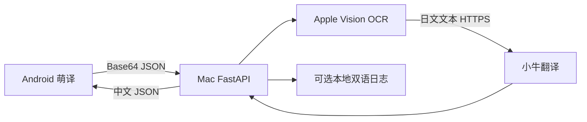

# MoeOCRServer

为 Android 开源屏幕翻译软件 [萌译（MoeTranslate）](https://github.com/murangogo/MoeTranslate) 提供的轻量级 macOS 翻译服务。利用 Apple Vision 原生 OCR 识别游戏截图中的日文，再通过小牛翻译返回中文，适合日语游戏、视觉小说等阅读场景。

> 这是作者于 2025 年末使用 Gemini 网页版辅助完成的第一个 Vibe Coding 项目。2026 年整理发布时保留原始核心流程和 API 接口，补充安全配置、依赖管理和测试。

## 工作原理



OCR 在 Mac 本地运行，不需要下载独立 OCR 模型。图片在内存中处理，只有识别出的文字发送给翻译供应商。翻译本身不是离线的。

## 安装

需要 macOS、[uv](https://docs.astral.sh/uv/) 和自己的[小牛翻译 API Key](https://niutrans.com/)。Python 由 uv 管理。

```bash
git clone https://github.com/zvision755/MoeOCRServer.git
cd MoeOCRServer
uv sync --locked --managed-python
cp .env.example .env
chmod 600 .env
```

在本地编辑 .env，填写 NIUTRANS_API_KEY。默认只监听本机；若要供手机通过可信局域网使用，将 MOE_HOST 设置为 0.0.0.0，并自行设置一个高强度随机 MOE_SERVER_TOKEN。

启动：

```bash
uv run --locked --env-file .env python my_ocr.py
```

也可以在 Finder 双击 run_server.command。按 Ctrl+C 停止服务；无需常驻后台。

## 萌译配置

手机与 Mac 应处于可互通的可信局域网。萌译设置中选择“直接上传图片进行翻译”，在自定义云端图片翻译 API 中填入：

| 选项 | 值 |
|---|---|
| 请求方法 | POST |
| Content-Type | application/json |
| 基础 URL | http://MAC_LAN_IP:8000/translate |
| 请求体 img | useimgbase64 |
| 请求体 source | ja |
| 请求体 target | zh |
| JSON 响应路径 | translation |
| 请求头 Authorization | Bearer YOUR_TOKEN |

将 MAC_LAN_IP 替换为 Mac 的实际局域网地址，YOUR_TOKEN 替换为你本地配置的 Token；如果没有开启鉴权则不填写该头。详见[萌译官方自定义图片 API 文档](https://www.moetranslate.top/docs/translationapi/custompic/)。

## 接口

POST /translate

```json
{"img":"<base64-encoded image>","source":"ja","target":"zh"}
```

成功响应：

```json
{"translation":"你好。"}
```

source 和 target 可省略，默认日语到简体中文。无文字返回空字符串。GET /health 返回服务状态；它不检查上游翻译 API 的有效性。

## 安全与隐私

- API Key、.env、真实游戏截图、私人翻译记录、虚拟环境不进入 Git。
- 日志默认关闭，设置 MOE_LOG_TRANSLATIONS=1 才保存日文与中文对照记录。
- 仅在可信网络使用局域网 HTTP；该连接不加密，不要直接将服务端口暴露到公网。
- 调用小牛翻译使用 HTTPS、请求超时和受控错误信息。
- 当前仅支持日译简中，复杂竖排和特殊字体的 OCR 阅读顺序可能不理想。

## 测试

```bash
uv run --locked python -m unittest discover -s tests -v
```

使用模拟翻译响应和合成图片测试，不调用付费翻译 API。真实翻译需要有效的 Key 与网络连接。

## English overview

A lightweight macOS companion backend for the Android app MoeTranslate. It performs Japanese OCR locally using Apple Vision via ocrmac and translates recognized text to Simplified Chinese through NiuTrans. This is an independent project, not affiliated with MoeTranslate, Apple or NiuTrans.

## License

MIT. See LICENSE. Third-party dependencies retain their respective licenses.
